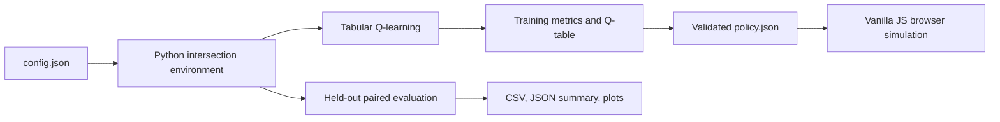

# DOPA-SYNC: Dopamine-Inspired Adaptive Traffic Signal Intelligence

DOPA-SYNC is a reproducible mini-project for studying tabular Q-learning in a small synthetic traffic-control problem. Python trains and evaluates the agent; the browser loads the actual exported Q-table and runs a fixed-step simulation. A live panel reports the model's temporal-difference (TD) reward prediction error.

## Scientific scope

The TD error is used as a computational signal informed by dopamine reward-prediction-error research. It is not dopamine measurement, a biochemical simulation, or a complete brain model. A successful traffic simulation cannot validate biological mechanisms. Traffic arrivals are synthetic and are not calibrated to observed traffic data. The environment is deliberately simplified to two aggregate opposing movements at one intersection.

## Architecture



Python and JavaScript share the documented state encoding, queue discretization, action constraints, transition ordering, reward, and TD equation. `tests/test_browser_parity.py` exercises explicit transitions in both implementations.

## Setup

Python 3.11 or newer is recommended. From this directory:

```bash
python -m pip install -r requirements.txt
python -m unittest discover -s tests
jupyter lab
```

Core training/evaluation dependencies are NumPy, Pandas, and Matplotlib. JupyterLab launches the notebook workflow. Node.js is used by the cross-language parity test; without Node, that test is skipped. The browser itself requires no Node.js or network service.

## Notebook workflow

Open `notebooks/dopa_sync_experiments.ipynb` and execute cells in order. It validates configuration and transitions, trains from environment interactions, evaluates held-out seeds against the fixed-time baseline, generates plots and result tables, and exports/round-trips the browser policy. The separate runnable equivalent is:

```bash
python -m src.run_pipeline
```

No results are bundled as example measurements. Running either workflow creates actual experiment outputs in `artifacts/` and `results/`.

## Browser launch

After training and export, launch a simple local static server from the project root:

```bash
python -m http.server 8000
```

Open `http://localhost:8000/simulation/`. The page attempts to load `artifacts/policy.json` by relative path and validates its checksum before labeling it trained. You may also choose that JSON file with **Load policy JSON**. If no valid policy exists, select **Fixed time** for a clearly labeled baseline-only demonstration. Local HTTP is needed because browsers commonly restrict JSON fetches from `file://`; the server does not train the agent and provides no API.

## Configuration and outputs

Change episode length, synthetic arrival rates, minimum green, service capacity, queue boundaries, learning parameters, baseline phase length, seed, and scenario count in `config.json`.

- `artifacts/q_table.npy`: trained table for Python.
- `artifacts/training_metadata.json`: training seed, settings, and Q-table checks.
- `artifacts/policy.json`: schema-versioned, checksum-protected browser artifact.
- `results/training_episodes.csv`: actual episode metrics and TD summary.
- `results/evaluation_scenarios.csv`: one row per controller and held-out seed.
- `results/experiment_summary.json`: configuration, metric definitions, means, and sample standard deviations.
- `results/training_diagnostics.png`, `results/evaluation_comparison.png`: plots from actual run data.

The report skeleton is `docs/experimental_report_template.md`; its results section remains pending until runs are performed. Environment semantics and units are in `docs/methodology.md`.

## Troubleshooting

- A missing policy is not silently replaced by a learned policy. Run the notebook or `python -m src.run_pipeline`, then reload the page or select `artifacts/policy.json`.
- A checksum/schema error means the artifact is incomplete, modified, or incompatible; regenerate it from the trained Q-table.
- If browser launch via `file://` prevents JSON loading, use the local HTTP command above.
- Switching controller mode or demand pauses the simulation. Reset before comparing runs so controller timing and demand do not carry over.
- Training results can vary by configuration and seeds. The convergence diagnostic is not proof of a globally optimal policy.

## Verified references

1. Schultz, W., Dayan, P., & Montague, P. R. (1997). A neural substrate of prediction and reward. *Science, 275*(5306), 1593–1599. https://doi.org/10.1126/science.275.5306.1593
2. Sutton, R. S., & Barto, A. G. (2018). *Reinforcement Learning: An Introduction* (2nd ed.). The MIT Press. Hardcover ISBN 978-0-262-03924-6; publication date 13 November 2018. https://mitpress.mit.edu/9780262039246/reinforcement-learning/
3. Hollerman, J. R., & Schultz, W. (1998). Dopamine neurons report an error in the temporal prediction of reward during learning. *Nature Neuroscience, 1*, 304–309. https://doi.org/10.1038/1124

The first and third works are primary peer-reviewed research; Sutton and Barto is the standard reinforcement-learning textbook. The bibliography supports scientific context, not a claim that this traffic experiment tests dopamine biology.
